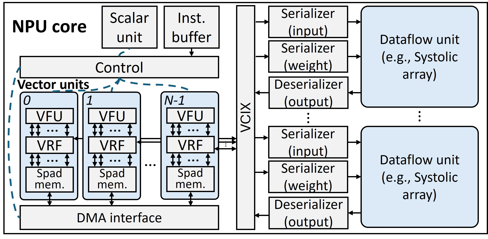

# PyTorchSim: A Comprehensive, Fast, and Accurate NPU Simulation Framework
[](https://github.com/PSAL-POSTECH/PyTorchSim/actions/workflows/docker-image.yml)

PyTorchSim is a comprehensive, high-speed, cycle-accurate NPU simulation framework.
- We define a RISC-V-based NPU architecture and implement PyTorch compiler backend to run inference & training for PyTorch models.
- Achieved high speed and accuracy with our novel Tile-Level Simulation (TLS) with compiler-generated Tile-Operation Graph (TOG), exploiting deterministic tile compute latency.
- A generic and extensible NPU architecture based on RISC-V vector extension.
- The functional simulator supports code correctness validation and data-dependent timing simulation.


For more details, please refer to our [paper](https://doi.org/10.1145/3725843.3756045)!
> **Disclaimer.** PyTorchSim is an independent project. It is neither part of the official [PyTorch](https://pytorch.org/) distribution nor affiliated with or endorsed by the PyTorch Foundation. The name reflects that this work builds on the open-source PyTorch compiler stack as its front-end for research purposes.

## Navigation
[Overview](#pytorchsim-framework-overview) | [Model Zoo](#model-zoo) | [Validation](#validation-against-tpu-v6e) | [Getting Started](#getting-started)

<!-- 
**Figure description**: we compare the simulation speed of PyTorchSim over [Accel-sim](https://accel-sim.github.io/) (a GPU simulator with Tensor Core model) as GPUs are widely used for deep learning and such a GPU simulator can be used to study systems for deep learning. We also include [mNPUsim](https://github.com/casys-kaist/mNPUsim) in the comparison. On the x-axis, we vary the size and workloads.


**Figure description**: PyTorchSim achieves significantly better accuracy than others ([SCALE-Simv3](https://github.com/scalesim-project/scale-sim-v3), [mNPUsim](https://github.com/casys-kaist/mNPUsim), [Timeloop](https://github.com/NVlabs/timeloop), [MAESTRO](https://github.com/maestro-project/maestro)) by supporting various optimizations, data transformations, and general vector operations. It achieved an 11.5% MAE (Mean Absolute Error) of runtime relative to the real TPUv3. -->

## PyTorchSim Framework Overview

PyTorchSim consists of **two main** components:
- **Compiler**: Integrated with the [PyTorch2](https://github.com/pytorch/pytorch) compiler stack; it generates NPU machine code and TOG for existing PyTorch models.
- **TOGSim**: Executes TOG for high-speed simulation and accurately models shared resources (DRAM, NoC) through integrated cycle-accurate simulators ([BookSim](https://github.com/booksim/booksim2) and [Ramulator2](https://github.com/CMU-SAFARI/ramulator2)).

PyTorchSim **supports**:
- DNN inference and [training](#training)
- Data-dependent timing modeling (e.g. sparsity)
- [One continuous TOGSim session](#one-togsim-session-one-continuous-log) (single log across multiple forwards)
- [Multi-tenancy](#multi-tenancy)
- [Compiler optimizations](#compiler-optimizations)
- [Mapping](#mapping)
- [L2 Cache](#l2-cache) (persistent cache)

## Model Zoo
| Model | Source | Status | Note |
|---|:-:|:-:|---|
| ResNet-18 |  | ✅ | channels last |
| ResNet-50 |  | ✅ | channels last |
| MobileNet-v2 |  | ✅ | `tests/models/MobileNet/` |
| YOLOv5 |  | ✅ | `tests/models/Yolov5/` — pretrained weights via torch.hub |
| YOLO v5 / v8 (ultralytics parser) |  | ✅ | `tests/models/Yolo/test_yolo.py` — built from YAML with random weights; `--version` also builds v3 to 26 |
| BERT |  | ✅ | |
| GPT-2 |  | ✅ | |
| ViT |  | ✅ | `tests/models/test_vit.py` |
| Mistral |  | ✅ | |
| Stable-diffusion v1 | 🤗 | ✅ | |
| Llama 2 / 3 / 3.1 / 3.2 / 3.3 | 🤗 | ✅ | `tests/models/Llama/` — one block at the real 8B width |
| Llama 3.2 Vision (Mllama) | 🤗 | ✅ | `tests/models/Llama/test_mllama.py` — both towers, the vision one at its real 4 tiles |
| Qwen 1.5 / 2 / 2.5 / 3 | 🤗 | ✅ 🎯 | `tests/models/Qwen/` — one block per version at its real width; Qwen 1 is not covered |
| Qwen2-VL / Qwen2.5-VL | 🤗 | ⚠️ | `tests/models/Qwen/test_qwen_vl.py` — end to end, and at the real 1280 vision width with `--preset 2b` |
| Qwen1.5-MoE / Qwen3-MoE | 🤗 | ✅ 🎯 | `tests/models/Qwen/test_qwen.py --preset 2-moe / 3-moe` — 8 experts instead of the shipped 60 and 128 |
| DeepSeek-V3 (base) | 🤗 | ✅ | `tests/models/DeepSeek/` — a few ops (the gate among them) are not cycle-modeled |
| SwinV2 | 🤗 | ✅ | `tests/models/test_swinv2.py` (shifted-window attention) |
| CLIP (vision) | 🤗 | ✅ | `tests/models/test_clip.py` |
| ConvNeXt V2 | 🤗 | ✅ | `tests/models/test_convnextv2.py` (channels-first LayerNorm, depthwise conv) |
| Llama 4 | 🤗 | ✅ | `tests/models/Llama/test_llama4.py` — MoE in every layer, experts scaled to 4; `--preset scout` builds the real 5120 width but stops in the functional simulator |
| Broader model support | — | ⏳ | In development |

✅ runs end to end on PyTorchSim · ⚠️ runs with the noted limits · ⏳ in development · 🎯 timing validated against TPU v6e
<!-- ## Requirements

### OS Distribution
Recommended: Ubuntu 22.04

### Tested Environment
```bash
gcc == 11.4.0
g++ == 11.4.0
cmake == 3.26.4
conan == 1.56.0
python >= 3.10
pytorch == 2.2.0
riscv64-unknown-elf-gcc == 13.2.0
```
Our provided Docker environment resolves software dependencies.

### Hardware Dependencies
Any x86 hardware capable of running Docker with more than 20 GB of memory -->

## Validation against TPU v6e

One decoder layer of each target model, at every sequence length the v6e table measures, timed on
PyTorchSim and compared with the same layer on a real TPU v6e. The error is
(simulated / measured - 1) x 100, so a positive bar is the simulator being the slower of the two.
The numbers behind both figures are `validation/grid/sim.csv` (ours) and `validation/grid/v6e.csv`
(the archive row each point is compared against); the nightly grid job refreshes the first and
redraws these pictures from it.


## Supported Operations
- GEMM
- Batched GEMM
- Convolution
- Elementwise
- Reduction
- Batchnorm
- Layernorm
- Softmax
- Transpose
- View
- Activation
- Pooling
- Etc (WIP)

## Getting Started
### Quick start with pre-built Docker image

To download the latest Docker image and set up the environment, use the following commands:

```bash
# Run the Docker container
docker run -it --ipc=host --name torchsim -w /workspace/PyTorchSim ghcr.io/psal-postech/torchsim-ci:v1.1.0 bash
```
### Manual Setting (Optional)
This script builds PyTorchSim-Triton-Backend -- the compiler, its LLVM and Triton, the Coprocessor environment (RISC-V toolchain, pk, Spike, gem5) and the TOGSim it carries (which needs `conan` 1.56 and `cmake` on `PATH`) -- from source for advanced users.
```bash
bash scripts/build_from_source.sh
```
The script checks out the commit pinned in [`third_party/pytorchsim-triton-backend.json`](third_party/pytorchsim-triton-backend.json), the same pin the CI docker image uses, so a from-source build matches the docker env.
### Run Examples
The `tests` directory contains several AI workload examples.
```bash
TORCHSIM_TIMING_MODE=1 python tests/ops/gemm/test_matmul.py
```
Timing is off by default (`TORCHSIM_TIMING_MODE=0`): each kernel is compiled and checked on Spike, and gem5 and TOGSim do not run. With `TORCHSIM_TIMING_MODE=1`, the TOGSim log is written to `${TORCHSIM_LOG_PATH}/<YYYYMMDD_HHMMSS>_<hash>.log`. The log file contains detailed core, memory, and interconnect stats.

### Run Your Own Model on PyTorchSim
You can run your own PyTorch model on PyTorchSim by setting up a custom NPU device.  
This method also applies when you want to simulate models beyond the provided examples.
```python
import torch

device = torch.device("npu:0")

# Declare your own model (e.g. resnet18 from torchvision)
from torchvision.models import resnet18
model = resnet18().eval()
x = torch.randn(1, 3, 224, 224, dtype=torch.float32)

# Move model and input tensors to the custom device
model.to(device)
x = x.to(device)

# Compile and run the model with PyTorchSim
compiled_model = torch.compile(dynamic=False)(model)
y = compiled_model(x)
```
`model` is your PyTorch model to be simulated, and `x` is the input tensor.
PyTorchSim automatically generates a Tile-Operation Graph (TOG), and runs it through the TOGSim backend.

### Result
Running log in CLI
```bash
[2026-04-22 11:29:20.139] [INFO] [pytorchsimfrontend.triton_backend.generated_wrapper] Wrapper Codegen Path = /workspace/PyTorchSim/outputs/.torchinductor/ru/cruz5mvhqeci3avet3ebv6outo6rbo7uiv477tj7u2zjlvfp6k5k.py
[2026-04-22 11:29:20.638] [INFO] [simulator.simulator] [Gem5] Gem5 simulation started
[2026-04-22 11:29:26.138] [INFO] [simulator.simulator] [Spike] Running Spike simulator
[2026-04-22 11:29:27.609] [INFO] [simulator.simulator] [TOGSim] TOGSim simulation started
[2026-04-22 11:29:28.217] [INFO] [simulator.simulator] [TOGSim] Simulation log is stored to "/workspace/PyTorchSim/togsim_results/20260422_112927_6fb9d704.log"
----------------------------
|Matmul Forward Test Passed|
----------------------------
```

Simulation consists of three steps

1. `Gem5` obtains compute latency for TOG.
2. `Spike` verifies the output code. It can also be used to model data-dependent timings.
3. `TOGSim` simulates an NPU architecture.

The log contains memory & core stats.
```bash
[2026-04-22 11:29:28.215] [info] [DRAM] Per-channel average bandwidth
[2026-04-22 11:29:28.215] [info] [DRAM] channel 0 | 15.51 GB/s avg., 51.56% of utilization | 4096 reads, 2048 writes
[2026-04-22 11:29:28.215] [info] [DRAM] channel 1 | 15.51 GB/s avg., 51.56% of utilization | 4096 reads, 2048 writes
[2026-04-22 11:29:28.215] [info] [DRAM] channel 2 | 15.51 GB/s avg., 51.56% of utilization | 4096 reads, 2048 writes
[2026-04-22 11:29:28.215] [info] [DRAM] channel 3 | 15.51 GB/s avg., 51.56% of utilization | 4096 reads, 2048 writes
[2026-04-22 11:29:28.215] [info] [DRAM] channel 4 | 15.51 GB/s avg., 51.56% of utilization | 4096 reads, 2048 writes
[2026-04-22 11:29:28.215] [info] [DRAM] channel 5 | 15.51 GB/s avg., 51.56% of utilization | 4096 reads, 2048 writes
[2026-04-22 11:29:28.215] [info] [DRAM] channel 6 | 15.51 GB/s avg., 51.56% of utilization | 4096 reads, 2048 writes
[2026-04-22 11:29:28.215] [info] [DRAM] channel 7 | 15.51 GB/s avg., 51.56% of utilization | 4096 reads, 2048 writes
[2026-04-22 11:29:28.215] [info] [DRAM] channel 8 | 15.51 GB/s avg., 51.56% of utilization | 4096 reads, 2048 writes
[2026-04-22 11:29:28.215] [info] [DRAM] channel 9 | 15.51 GB/s avg., 51.56% of utilization | 4096 reads, 2048 writes
[2026-04-22 11:29:28.215] [info] [DRAM] channel 10 | 15.51 GB/s avg., 51.56% of utilization | 4096 reads, 2048 writes
[2026-04-22 11:29:28.215] [info] [DRAM] channel 11 | 15.51 GB/s avg., 51.56% of utilization | 4096 reads, 2048 writes
[2026-04-22 11:29:28.215] [info] [DRAM] channel 12 | 15.51 GB/s avg., 51.56% of utilization | 4096 reads, 2048 writes
[2026-04-22 11:29:28.215] [info] [DRAM] channel 13 | 15.51 GB/s avg., 51.56% of utilization | 4096 reads, 2048 writes
[2026-04-22 11:29:28.215] [info] [DRAM] channel 14 | 15.51 GB/s avg., 51.56% of utilization | 4096 reads, 2048 writes
[2026-04-22 11:29:28.215] [info] [DRAM] channel 15 | 15.51 GB/s avg., 51.56% of utilization | 4096 reads, 2048 writes
[2026-04-22 11:29:28.215] [info] [DRAM] channels 0..15 combined | 248.13 GB/s aggregate, 51.56% of utilization (avg. per channel) | 65536 reads, 32768 writes
[2026-04-22 11:29:28.215] [info] ===== Instructions count =====
[2026-04-22 11:29:28.215] [info] Core [0] : MOVIN    inst_count: 2
[2026-04-22 11:29:28.215] [info] Core [0] : MOVOUT   inst_count: 1
[2026-04-22 11:29:28.215] [info] Core [0] : COMP     inst_count: 81 (GEMM: 80, Vector: 1)
[2026-04-22 11:29:28.215] [info] Core [0] : BAR      inst_count: 80
[2026-04-22 11:29:28.215] [info] ========= Core stat =========
[2026-04-22 11:29:28.215] [info] Core [0] : Systolic array [0] utilization(%): 34.37, active_cycles: 4096, idle_cycles: 7821
[2026-04-22 11:29:28.215] [info] Core [0] : Systolic array [1] utilization(%): 34.37, active_cycles: 4096, idle_cycles: 7821
[2026-04-22 11:29:28.215] [info] Core [0] : DMA active_cycles: 6144, DMA idle_cycles: 5773, DRAM BW: 248.000 GB/s (98304 responses)
[2026-04-22 11:29:28.215] [info] Core [0] : Vector unit utilization(%): 2.55, active cycle: 304, idle_cycle: 0
[2026-04-22 11:29:28.215] [info] Core [0] : NUMA local memory: 98304 requests, remote memory: 0 requests
[2026-04-22 11:29:28.215] [info] Core [0] : Total_cycles: 11917
[2026-04-22 11:29:28.215] [info] Total execution cycles: 11917
[2026-04-22 11:29:28.215] [info] Wall-clock time for simulation: 0.602899 seconds
```
The log is dumped in `TORCHSIM_LOG_PATH` and you can set the path as below.
```bash
export TORCHSIM_LOG_PATH=/tmp/torchinductor # output file dump path
```

## Training
`backward()` automatically generates TOG and executes simulation for backward propagation. If you want to simulate optimizers on NPU units, you can compile the optimizer’s step function.
```python
optimizer = torch.optim.Adam(model.parameters(), lr=0.001)
compiled_step = torch.compile(dynamic=False)(optimizer.step)

optimizer.zero_grad()
loss.backward()
compiled_step()
```
`tests/models/test_mlp.py` provides an example of MLP training.

## One TOGSim session, one continuous log

By default, each compiled operation can run TOGSim in a standalone way—typically **one simulator process and one log file per kernel**. That matches single-kernel workflows but splits traces when you run many forwards in a row.

`with torch.npu.TOGSimulator(config_path=...)` keeps **one TOGSim session** open for the block: successive calls (e.g. multiple `compiled_model(...)` forwards) run in sequence in the same process, so the timeline and shared resources continue in a single log instead of restarting for every op. `TORCHSIM_TARGET` is set to the given YAML for the block so codegen and TOGSim still share one hardware file.

Use the same API you already use; only wrap the region you want co-simulated:

```python
import torch

# ... build model, torch.compile, tensors on npu:0 as usual ...

with torch.npu.TOGSimulator(config_path=config):
    y = compiled_model(x)
```

<a id="multi-tenancy"></a>

## Multi-tenancy and explicit scheduling (`launch_model`)

For **multi-tenant** or **interleaved** execution, you usually need to attach a **timestamp** and a `stream_index` to each launch so the simulator can order work correctly. Use `torch.npu.launch_model(compiled_model, *inputs, stream_index=..., timestamp=...)` for that; plain `compiled_model(x)` does not carry those parameters.

`stream_index` is the **request-queue / partition index** in the TOGSim config: it must match the **values** in the `partition` map (each queue index is mapped to a **core**). For example, `stream_index=0` goes to the queue bound to `core_0`, `stream_index=1` to the queue for `core_1`, and so on.

`timestamp`** is in **nanoseconds** (simulation time for ordering launches). Use `0` when you do not need explicit times beyond submission order.

```python
with torch.npu.TOGSimulator(config_path=config):
    torch.npu.launch_model(opt_model1, x1, stream_index=0, timestamp=0)
    torch.npu.launch_model(opt_model2, x2, stream_index=1, timestamp=0)
    torch.npu.synchronize()
    torch.npu.launch_model(opt_model1, x1, stream_index=0, timestamp=0)
    torch.npu.launch_model(opt_model2, x2, stream_index=1, timestamp=0)
```

Here `synchronize()` acts as a barrier: it does not return until every `launch_model` issued **above** it has finished in the simulator. The later pair of `launch_model` calls therefore runs only after those earlier models have fully completed—so the sync is the point in the timeline where **all preceding launches are done**.

Use a TOGSim config(`.yml`) that defines **partitions** when mapping queues to cores, for example:

- `num_partition`: Number of independent request queues (valid `stream_index` values are `0 … num_partition-1`).
- `partition`: Maps each **core** name to a **queue index**; that index is the same `stream_index` you pass to `launch_model`.

```
  "num_partition" : 2,
  "partition": {
    "core_0": 0,
    "core_1": 1
  }
```

Here `stream_index=0` selects queue `0` (core_0), `stream_index=1` selects queue `1` (core_1).

### 3. Load generation (Poisson arrivals)

A Poisson generator of synthetic **arrival times** (in **milliseconds**), written in the example below, drives the load. Merge those with `launch_model`: convert each time to **nanoseconds** for `timestamp`, set `stream_index` to the target partition queue, and run all launches inside one `with torch.npu.TOGSimulator(...)` so a **single** log captures the full trace.

```python
import numpy as np


def poisson_request_generator(lambda_requests, max_msec_time=None):
    """Yield synthetic arrival times in milliseconds (first sample is 0)."""
    current_time = 0.0
    yield 0
    while max_msec_time is None or current_time < max_msec_time:
        current_time += np.random.exponential(scale=1000 / lambda_requests)
        if max_msec_time is not None and current_time > max_msec_time:
            break
        yield current_time


model0_lambda = 5.0
model1_lambda = 3.0
max_time_msec = 1000.0  # Poisson horizon [ms]

events = []
for t in poisson_request_generator(model0_lambda, max_msec_time=max_time_msec):
    x = torch.randn(1, 3, 224, 224, device=device)
    events.append((t, 0, opt_model0, (x,)))  # stream_index 0 → queue / partition 0

for t in poisson_request_generator(model1_lambda, max_msec_time=max_time_msec):
    x = torch.randn(128, 768, device=device)
    events.append((t, 1, opt_model1, (x,)))  # stream_index 1 → queue / partition 1

with torch.npu.TOGSimulator(config_path=config):
    for t_msec, stream_index, model, args in events:
        torch.npu.launch_model(
            model,
            *args,
            stream_index=stream_index,
            timestamp=int(t_msec * 1e6),
        )  # ms → ns
```

The two Poisson streams are **combined and sorted by time** so launches follow a single global arrival order.

## Compiler Optimizations
PyTorchSim compiler supports several fusion optimizations:
- GEMM prologue fusion
- GEMM epilogue fusion
- GEMM reduction fusion
- CONV epilogue fusion

Depending on tensor shape, use different convolution template:
- Single batch optimization
- Multi-channel optimization

## Mapping
A GEMM's tile is chosen the way Inductor chooses any template config: the mm/bmm/addmm/baddbmm
template is offered at this machine's tiles (the `codegen_autotune_template_topk`
largest that fit the scratchpad, 4 by default), and the selection keeps one.
`codegen_mapping_strategy` says how (see [Run settings](#run-settings)):

- **`autotune`** (the default), in timing mode: each offered config is compiled and simulated on
  TOGSim, and the fewest cycles wins. A template with an epilogue (bias, activation) is picked by
  Inductor's epilogue-fusion benchmark, which simulates the top configs with the epilogue fused.
  Outside timing mode, the first offered config, the largest tile.
- **`heuristic`**: the first offered config only, timed or not; a recorded pick is not used.
- **`external-then-heuristic`**, **`external-then-autotune`**: the tile `codegen_external_mapping_file`
  states for the shape, when it states one; otherwise as `heuristic` or `autotune`. The file maps
  `"M_N_K"` (a bmm's per batch) to exactly `TILE_M`, `TILE_N` and `TILE_K`, and a tile this machine
  cannot build is refused:
  ```json
  {"1024_1024_1024": {"TILE_M": 512, "TILE_N": 512, "TILE_K": 256}}
  ```
- **Resident mm**: an mm whose operand the compiler's `copy_node.plan` can hold whole is built as the
  resident mm at its planned tile, under every strategy; only an external tile for the shape replaces it.
- **Recorded picks**: `pytorchsim/selection/<machine>.json` holds picks in Inductor's lookup-table
  format, for the compiler, machine and TOGSim they were timed with. A recorded config is the only
  one offered, in either mode. A timed run appends its picks to `$TORCHSIM_DUMP_PATH/selection.jsonl`;
  `python scripts/selection_merge.py <selection.jsonl>...` folds them into the record. A record
  holds the pick without an epilogue.

Each kernel's `meta.json` says where its tile came from: `tile_source` is `timed`, `recorded`,
`recorded_unfused` (a recorded pick built with an epilogue fused), `planned` (the resident mm), `external` or `heuristic`.

### Run settings
Each is its environment variable, else the key of the same name in the machine file
`TORCHSIM_TARGET` names, else its default. The compiler and TOGSim read none of these keys.
`pytorchsim_timing_mode` is fixed once `torch` is imported.

| Key | Environment variable | Default |
|---|---|---|
| `pytorchsim_functional_mode` | `TORCHSIM_FUNCTIONAL_MODE` | `1` (run Spike) |
| `pytorchsim_timing_mode` | `TORCHSIM_TIMING_MODE` | `0` (no TOGSim) |
| `pytorchsim_functional_verify_per_kernel` | `TORCHSIM_FUNCTIONAL_VERIFY_PER_KERNEL` | `0` |
| `codegen_autotune_template_topk` | `TORCHSIM_CODEGEN_AUTOTUNE_TEMPLATE_TOPK` | `4` |
| `codegen_mapping_strategy` | `TORCHSIM_CODEGEN_MAPPING_STRATEGY` | `autotune` |
| `codegen_external_mapping_file` | `TORCHSIM_CODEGEN_EXTERNAL_MAPPING_FILE` | none; a relative path is the machine file's directory's (the working directory's from the variable) |

## L2 Cache
TOGSim models an optional L2 data cache between the cores and DRAM. Set `l2d_type: datacache` and `l2d_config` in the [TOGSim config](#togsim-configuration) to use it. The `l2d_config` follows the same configuration method as [AccelSim](https://github.com/accel-sim/accel-sim-framework).

## Compiler Configuration
`pytorchsim/config.py` reads PyTorchSim's settings from environment variables, else from the machine file's keys of the same name (see [Run settings](#run-settings)). The machine itself is a TOGSim YAML file (see [TOGSim Configuration](#togsim-configuration)).
```bash
export TORCHSIM_DIR=/workspace/PyTorchSim # home directory
export TOGSIM_DIR=/workspace/pytorchsim-triton-compiler/third_party/TOGSim # TOGSim checkout: include/, build/bin/Simulator, configs/ (default: the one the compiler carries)
export TORCHSIM_TARGET=tpuv6e # the machine: a name under $TOGSIM_DIR/configs, or a path to a .yml (default tpuv6e)

export TORCHSIM_TIMING_MODE=1 # 1 = time each kernel on gem5 and TOGSim (default 0)
export TORCHSIM_FUNCTIONAL_MODE=0 # 0 = skip Spike for faster runs; outputs are then not computed (default 1)
export TORCHSIM_FUNCTIONAL_VERIFY_PER_KERNEL=1 # check each kernel against a CPU golden (default 0)
export TORCHSIM_CODEGEN_AUTOTUNE_TEMPLATE_TOPK=4 # GEMM tiles offered to the selection (default 4)
export TORCHSIM_CODEGEN_MAPPING_STRATEGY=autotune # heuristic | autotune | external-then-heuristic | external-then-autotune (default autotune)
export TORCHSIM_CODEGEN_EXTERNAL_MAPPING_FILE=tiles.json # "M_N_K" -> TILE_M/N/K, read by the external- strategies
```
## TOGSim Configuration


TOGSim is its own repository, [PSAL-POSTECH/TOGSim](https://github.com/PSAL-POSTECH/TOGSim), which the compiler carries as `third_party/TOGSim`. Its `configs/` directory holds **YAML** (`.yml`) hardware descriptions: `$TOGSIM_DIR/configs`, which is `/workspace/pytorchsim-triton-compiler/third_party/TOGSim/configs` in the Docker image. Set `TORCHSIM_TARGET` to one of them, by name (`tpuv6e`) or by path. The **same file** is read by the **compiler** (`vpu_*`, `isa`, `vcix`, `address_map`), by **PyTorchSim** (`pytorchsim/config.py`) for the [run settings](#run-settings) (`pytorchsim_*`, `codegen_*`), and by **TOGSim** (`src/Common.cc` there) for the simulator-specific keys below.

### Reference layout

The default machine, `configs/tpuv6e.yml`, with the optional keys commented out:

```yaml
# --- Core (TOGSim) ---
num_cores: 1
core_freq_mhz: 1751
core_stats_print_period_cycles: 200
num_systolic_array_per_core: 2
systolic_array_split: round_robin
systolic_array_unit: TPUV6E_MXU
dma_load_latency_cycles: 27
dma_load_ready_cycles: 842
# sa_weight_buffer_depth: 2   # per-SA resident weight slots; must be > 0 (default 2). Raise to loosen the preload throttle.
# core_type: [ws_mesh]        # one entry per core; ws_mesh is the only core type

# --- VPU / scratchpad / ISA (compiler; same YAML) ---
vpu_num_lanes: 128
vpu_spad_size_kb_per_lane: 1024
isa: [m, a, f, d, c, v, zvfh, zvfbfmin, zvl256b, vcix_tpuv6e]
vcix: {tpu_mxu_queue_entries: 512}
address_map: {spad_vaddr: 0xd0000000, spad_paddr: 0x2000000000, dram_base: 0x80000000, dram_size: 107374182400}

# --- DRAM config ---
dram_type: ramulator2          # ramulator2 | simple
dram_channels: 32
dram_stats_print_period_cycles: 200
ramulator_config_path: ../configs/ramulator2_configs/HBM3_TPUv6e.yaml  # resolved relative to this YAML's directory
# For ramulator2: request size, DRAM MHz, and per-channel peak GB/s are derived from the Ramulator YAML.
# dram_freq_mhz, if given, must exactly match MHz derived from Ramulator tCK or startup fails.

# simple DRAM (alternative to ramulator2):
# dram_type: simple
# dram_latency: 100
# dram_req_size_byte: 32   # optional, default 32
# dram_freq_mhz: <MHz>     # defaults to core_freq_mhz if omitted
# Optional bandwidth cap (set only one of the two):
# dram_bandwidth_gbps_per_channel: ...
# dram_bandwidth_gbps_total: ...
# If either bandwidth key is set, dram_freq_mhz is required.

# Optional: NUMA-style DRAM partitions (channels must divide evenly)
# dram_num_partitions: 2

# --- Optional L2 (TOGSim) ---
l2d_type: datacache            # nocache (default if omitted) | datacache
l2d_config: S:128:128:512,32,L:T:m:W:L,A:192:4,32:0,32   # AccelSim-style string, required for datacache
# l2d_hit_latency: ...

# --- Interconnect (TOGSim) ---
icnt_type: simple              # simple | booksim2
icnt_latency_cycles: 10        # used when icnt_type is simple
icnt_freq_mhz: 1751
icnt_injection_ports_per_core: 32
# icnt_stats_print_period_cycles: 0   # optional
# For icnt_type: booksim2, use booksim_config_path:
# booksim_config_path: ../configs/booksim2_configs/fly_c16_m16.icnt

# --- Run settings (PyTorchSim; the compiler and TOGSim ignore them) ---
pytorchsim_functional_mode: 1  # 1 = run Spike validation, 0 = skip for faster runs
pytorchsim_timing_mode: 1
codegen_autotune_template_topk: 4
codegen_mapping_strategy: autotune    # heuristic | autotune | external-then-heuristic | external-then-autotune
codegen_external_mapping_file: ''    # read by the external- strategies

# --- Optional partitions (TOGSim; multi-queue) ---
# num_partition: 2
# partition:
#   core_0: 0
#   core_1: 1
```

### Key fields (quick reference)

One-line meaning for each group (details in the YAML block above).

- **Core (`num_cores`, `core_freq_mhz`, `core_stats_print_period_cycles`, `num_systolic_array_per_core`, `systolic_array_*`, `dma_*`, `sa_weight_buffer_depth`, optional `core_type`)**: how many cores, their clock, stats cadence, systolic count per core and its unit, DMA costs, and the per-SA resident weight-slot count (must be > 0; bounds preload run-ahead—raise it to loosen the throttle).
- **VPU / ISA (`vpu_*`, `isa`, `vcix`, `address_map`)**: vector lane count and per-lane scratchpad (KB), the ISA and accelerator the **compiler** targets, and the address map. A machine file that leaves any of them out is refused.
- **DRAM (`dram_type`, `dram_channels`, …)**: `ramulator2` uses `ramulator_config_path`; `simple` uses fixed latency and optional bandwidth caps (`dram_bandwidth_gbps_*`, `dram_freq_mhz` when capped). `dram_num_partitions` splits channels for NUMA-style addressing.
- **Interconnect (`icnt_*`, `booksim_config_path`)**: `simple` adds fixed hop latency (`icnt_latency_cycles`); `booksim2` points at a BookSim2 topology file.
- **Codegen (`codegen_*`)**: how many of this machine's GEMM tiles are offered to the selection, how one is picked, and the external tiles (see [Mapping](#mapping)).
- **L2 (`l2d_type`, `l2d_config`, optional `l2d_hit_latency`)**: optional data cache between cores and DRAM; `l2d_config` uses AccelSim-style cache geometry strings.
- **Partitions (`num_partition`, `partition`)**: request queues per partition and `core_i` → queue index mapping for multi-tenant / `launch_model` routing. The shipped machines define one queue.
- **Run settings (`pytorchsim_*`, `codegen_*`)**: timing, Spike, per-kernel check and how a GEMM's tile is picked; each is its environment variable, else this file's key, else its default (see [Run settings](#run-settings)).

## Tutorial
Check out our [ISPASS 2026 tutorial](https://www.youtube.com/playlist?list=PLYIb5dkr4isJ1ERKTKFoWdCKMUOaay2Nn) to learn:
- PyTorchSim architecture, motivation, and design goals
- The end-to-end PyTorch compilation pipeline (PyTorch code → FX → Triton → MLIR → LLVM → ISA)
- TPU-style NPU architecture and memory hierarchy
- Running and analyzing operators and DNN models in PyTorchSim
- Scheduling, mapping, optimization, and performance analysis tools
- Extending PyTorchSim with custom NPU ISA instructions

For tutorial setup, please refer to the [JupyterHub setup guide](https://github.com/PSAL-POSTECH/PyTorchSim/blob/ispass2026/tutorial/jupyterhub/README.md).

## Future Works
We plan to broaden **model coverage** (more workloads), support **dynamic-shape**, and extend **eager-mode** integration so a wider range of PyTorch programs can be simulated.

## Artifact Evaluation
Artifact evaluation is available for v1.0.0.
The following scripts reproduce the validation and speedup results from the paper.
### Build
```bash
docker run -it --ipc=host --name torchsim -w /workspace/PyTorchSim ghcr.io/psal-postech/torchsim-ci:v1.0.0 bash
```

To generate validation results
```bash
# Run a cycle accuracy script
./experiments/artifact/cycle_validation/run_cycle.sh
```
To generate speedup results
```bash
# Run a speedup accuracy script
./experiments/artifact/speedup/run_speedup.sh
```

## Contributing
We welcome any contributions and issue reports.
Please refer to the [Contributing Guide](https://github.com/PSAL-POSTECH/PyTorchSim?tab=contributing-ov-file) for details.

## Citation
If you use PyTorchSim for your research, please cite the following paper.
```
@INPROCEEDINGS{yang2025pytorchsim,
  author={Yang, Wonhyuk and Shin, Yunseon and Woo, Okkyun and Park, Geonwoo and Ham, Hyungkyu and Kang, Jeehoon and Park, Jongse and Kim, Gwangsun},
  title={PyTorchSim: A Comprehensive, Fast, and Accurate NPU Simulation Framework},
  booktitle={Proceedings of the 58th IEEE/ACM International Symposium on Microarchitecture},
  pages={1363–1380},
  year={2025},
  doi={10.1145/3725843.3756045},
  series={MICRO '25}
}
```
